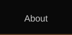
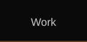
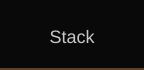
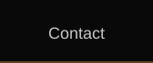
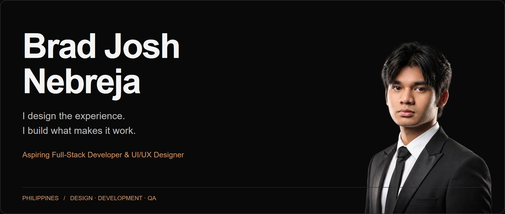

<p><a href="https://nebreja-portfolio-website.vercel.app/"></a><a href="#about"></a><a href="#work"></a><a href="#experience"></a><a href="#stack"></a><a href="#contact"></a></p>

<a href="https://nebreja-portfolio-website.vercel.app/"></a>

<p align="center"><a href="https://nebreja-portfolio-website.vercel.app/"></a> <a href="https://www.linkedin.com/in/josh-nebreja-894248402/"></a> <a href="https://www.facebook.com/brad.josh.nebreja"></a> <a href="mailto:bradjosh.nebreja05@gmail.com"></a></p>

<a id="about"></a>

## About

I’m Brad Josh Nebreja, an aspiring full-stack developer and UI/UX designer based in Calamba City, Laguna, Philippines. I turn complex ideas into clear, useful digital experiences, with attention to how websites look, function and help people get things done.

I’m currently developing **PraisePoint**, a church presentation workspace. It is my work in progress for 2026 and remains under development. I’m also looking for an internship where I can contribute to interface design, web development and quality assurance.

<a id="work"></a>

## Selected Works

| Project | What it does | Links |
| --- | --- | --- |
| **PraisePoint** · In development | A church workspace for slides, songs, service plans, media and offline presenting. | [Live preview](https://gather-ccf-presentations.web.app/) · [Source](https://github.com/Josh-L30/PraisePoint) |
| **Checkpoint** | Provincial bus arrival estimates, stop discovery and role-based staff tools. | [Live site](https://onroute.cloud/) · [Source](https://github.com/Josh-L30/Checkpoint) |
| **CPC Centralized System** | Connects sales, production, inventory and logistics operations. | [Project details](https://nebreja-portfolio-website.vercel.app/project.html?project=cpc) · No public live site to protect client information |
| **CinemaBuddy** | Movie-discovery interface and an interactive Figma prototype for a 2024 school project. | [Live site](https://cinema-buddy.vercel.app/) |
| **Personal Portfolio** | My projects, experience, skills and contact information in a responsive website. | [Live site](https://nebreja-portfolio-website.vercel.app/) · [Source](https://github.com/Josh-L30/Nebreja-Portfolio-Website) |

<a id="experience"></a>

## Experience

| When | Role & project | Contribution |
| --- | --- | --- |
| **2026–Present** | **Web Developer · PraisePoint** | Building a church presentation workspace. Current work in progress; still under development. |
| **2026** | **Development Contributor & QA Tester · Checkpoint** | Helped build the website and tested its features and user experience. |
| **2025–2026** | **Capstone Project Lead · Containerboard Packaging Corporation** | Led the team building the centralized system across Sales, Production, Inventory and Logistics. |
| **2025–2026** | **UI/UX Designer Lead · CPC Centralized System** | Led interface design and supported frontend development with HTML, CSS, JavaScript and PHP. |
| **2024** | **UI Designer & Prototype Designer · CinemaBuddy** | Designed the interface and interactive Figma prototype for a school project. |

<a id="stack"></a>

## Tech Stack

### Frontend

<table><tr>
<td align="center"><br /><sub>HTML</sub></td>
<td align="center"><br /><sub>CSS</sub></td>
<td align="center"><br /><sub>JavaScript</sub></td>
<td align="center"><br /><sub>TypeScript</sub></td>
<td align="center"><br /><sub>React</sub></td>
<td align="center"><br /><sub>Tailwind CSS</sub></td>
</tr></table>

### Backend

<table><tr>
<td align="center"><br /><sub>PHP</sub></td>
<td align="center"><br /><sub>Express.js</sub></td>
<td align="center"><br /><sub>Laravel WebSocket</sub></td>
<td align="center"><br /><sub>Node.js</sub></td>
</tr></table>

### Databases & Services

<table><tr>
<td align="center"><br /><sub>MySQL</sub></td>
<td align="center"><br /><sub>Firebase</sub></td>
<td align="center"><br /><sub>MongoDB</sub></td>
<td align="center"><br /><sub>Vercel</sub></td>
<td align="center"><br /><sub>Supabase</sub></td>
<td align="center"><br /><sub>Cloudflare</sub></td>
</tr></table>

### AI

<table><tr>
<td align="center"><br /><sub>Gemini</sub></td>
<td align="center"><br /><sub>OpenAI</sub></td>
<td align="center"><br /><sub>Claude</sub></td>
<td align="center"><br /><sub>Antigravity</sub></td>
<td align="center"><br /><sub>Grok</sub></td>
<td align="center"><br /><sub>Copilot</sub></td>
<td align="center"><br /><sub>Cursor AI</sub></td>
</tr></table>

### Design & Programming

<table><tr>
<td align="center"><br /><sub>Figma</sub></td>
<td align="center"><br /><sub>Canva</sub></td>
<td align="center"><br /><sub>Java</sub></td>
<td align="center"><br /><sub>Python</sub></td>
<td align="center"><br /><sub>C++</sub></td>
</tr></table>

### Development & Collaboration

<table><tr>
<td align="center"><br /><sub>Visual Studio Code</sub></td>
<td align="center"><br /><sub>Microsoft 365</sub></td>
<td align="center"><br /><sub>Microsoft Loop</sub></td>
<td align="center"><br /><sub>Vite</sub></td>
<td align="center"><br /><sub>Git</sub></td>
<td align="center"><br /><sub>GitHub</sub></td>
</tr></table>

<a id="contact"></a>

## Let’s make it work

I’m open to internship opportunities in web development, UI/UX design and QA.

[Visit my portfolio](https://nebreja-portfolio-website.vercel.app/) · [Send me an email](mailto:bradjosh.nebreja05@gmail.com)

<p align="center"><a href="https://nebreja-portfolio-website.vercel.app/"></a> <a href="https://www.linkedin.com/in/josh-nebreja-894248402/"></a> <a href="https://www.facebook.com/brad.josh.nebreja"></a> <a href="mailto:bradjosh.nebreja05@gmail.com"></a></p>

---

## About this repository

This is the source for my portfolio website, built with HTML, CSS, JavaScript ES modules, native Web Components and JSON. The interface uses black, white and caramel brown, with original-color project images and tool icons.

The website includes scroll-driven laptop scenes, a mobile name marquee, responsive navigation, project galleries, a Credentials carousel, a downloadable CV, a contact form and public GitHub contributions. Reduced-motion preferences and optional-service fallbacks are supported.

### Run locally

```sh
python -m http.server 8000 --bind 127.0.0.1
```

Open [localhost:8000](http://127.0.0.1:8000/). No build step or package installation is required. XAMPP and VS Code Live Server also work. Use an HTTP server because the site fetches JSON and uses JavaScript modules.

### Project structure

| Path | Purpose |
| --- | --- |
| `index.html` | Home, About, services, Selected Works, Experience and other main sections |
| `works.html`, `project.html` | Full work collection and project galleries |
| `stack.html`, `contact.html` | Full technology library and contact form |
| `data/content.json` | Projects, galleries, technology icons, credentials and public form configuration |
| `css/`, `js/` | Shared styles, native components, navigation and motion |
| `assets/` | Portraits, screenshots, fonts, icons, README graphics and CV |
| `api/github.js` | Read-only public contribution endpoint for Vercel |
| `tests/` | Content, gallery, browser and motion checks |
| `docs/` | Development notes, source attribution and third-party licenses |

### Updating and checking

Edit `data/content.json` for project and technology content; edit `index.html` for About and Experience. Keep the CV links, project totals and screenshot alternatives consistent when making changes.

```sh
python verify_assets.py
python -m unittest discover -s tests -p "test_*.py"
node --test tests/project-gallery.test.mjs tests/scene-timeline.test.mjs
```

With the local server running, open `/tests/browser.html` and click **Run checks**. These checks use viewport emulation; they do not replace physical-device testing.

### Hosting and contact

Vercel hosts the portfolio and the read-only GitHub activity endpoint. Web3Forms handles contact delivery. The ordinary static-server preview uses a dated contribution snapshot when the Vercel endpoint is unavailable. Keep private credentials and service-role keys out of frontend files and Git.

Local edits become public only after the production branch is pushed and Vercel completes its deployment. If the site looks outdated, check the deployed commit against GitHub before retrying the push.

See [development documentation](docs/portfolio-development.md) and [PraisePoint source notes](docs/praisepoint-project.md). Third-party license notices are retained in `docs/`.
