
<a href="https://nebreja-portfolio-website.vercel.app/">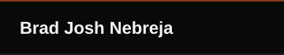</a><a href="#about">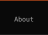</a><a href="#work">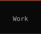</a><a href="#experience">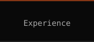</a><a href="#stack">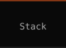</a><a href="#certifications">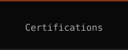</a><a href="#education">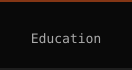</a><a href="#contact">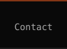</a>

<a href="https://nebreja-portfolio-website.vercel.app/">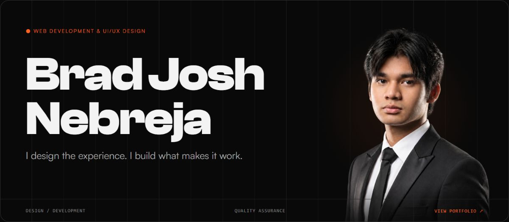</a>

    

<a href="https://nebreja-portfolio-website.vercel.app/#about">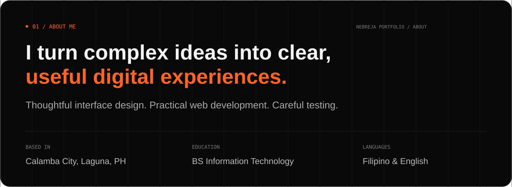</a>

<a href="https://nebreja-portfolio-website.vercel.app/#work">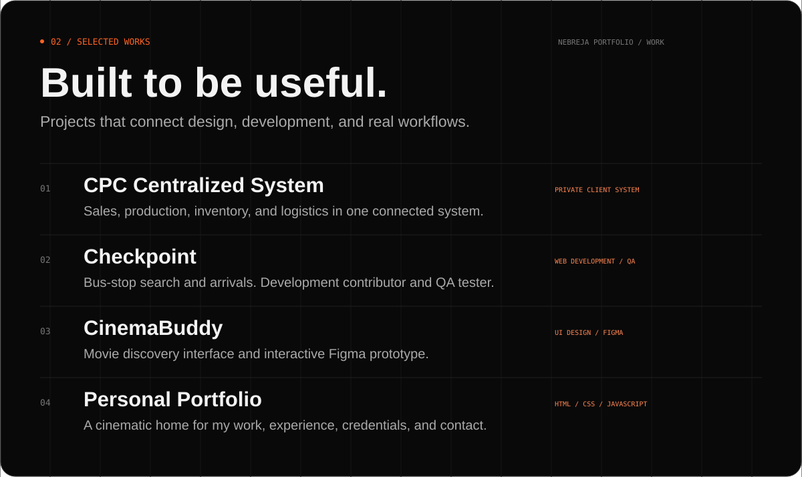</a>

<a href="https://onroute.cloud/">Checkpoint ↗</a> · <a href="https://cinema-buddy.vercel.app/">CinemaBuddy ↗</a> · <a href="https://nebreja-portfolio-website.vercel.app/">Personal Portfolio ↗</a>

<a href="https://nebreja-portfolio-website.vercel.app/#experience">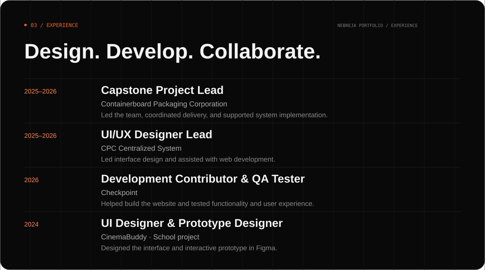</a>

<a href="https://nebreja-portfolio-website.vercel.app/#stack">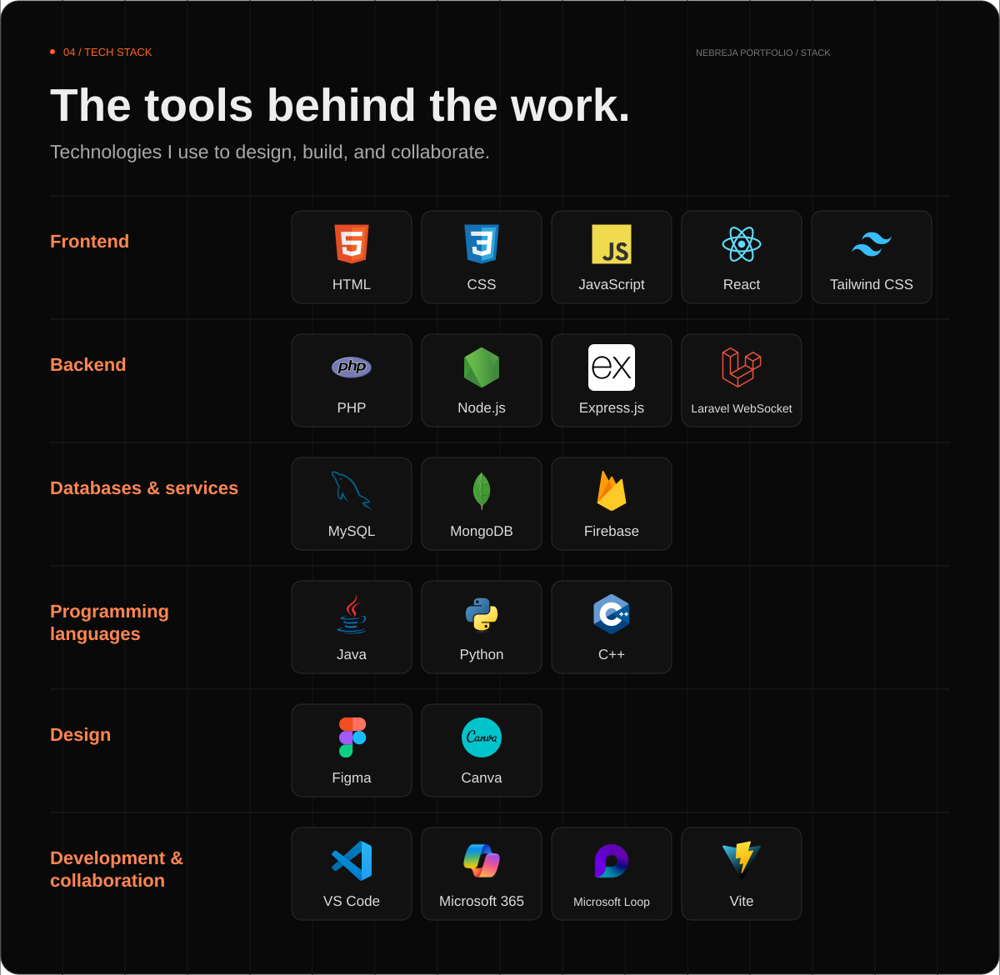</a>

<a href="https://nebreja-portfolio-website.vercel.app/#certifications">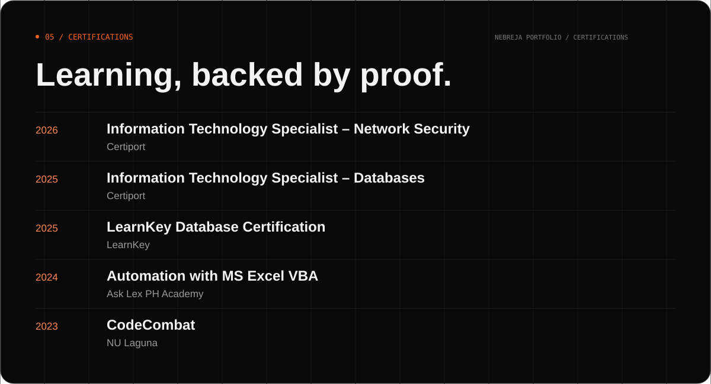</a>

<a href="https://nebreja-portfolio-website.vercel.app/#education">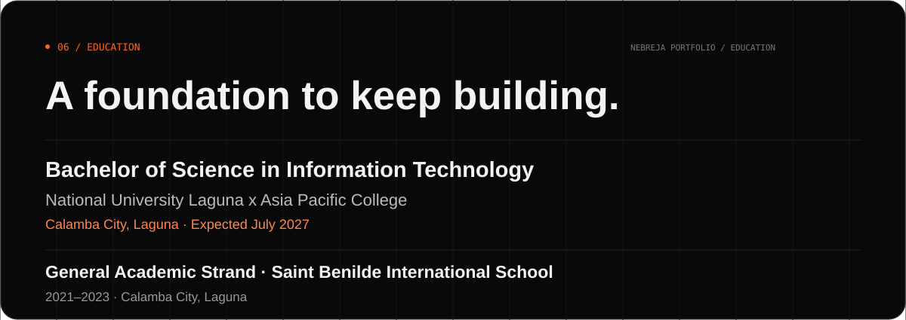</a>

<a href="https://nebreja-portfolio-website.vercel.app/#contact">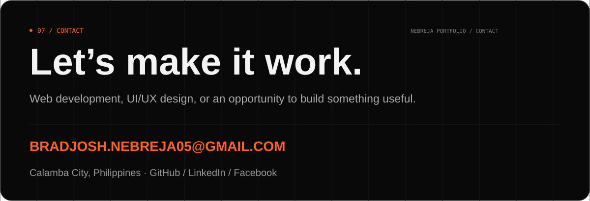</a>

    

Portfolio setup and source

Built with HTML, CSS, JavaScript ES modules, native Web Components, JSON, Web3Forms, and Vercel. No build step is required.

Run `python -m http.server 8000 --bind 127.0.0.1` from the repository root, then open http://127.0.0.1:8000/.

[Source code](https://github.com/Josh-L30/Nebreja-Portfolio-Website) · [Development documentation](https://github.com/Josh-L30/Nebreja-Portfolio-Website/blob/main/docs/portfolio-development.md)

